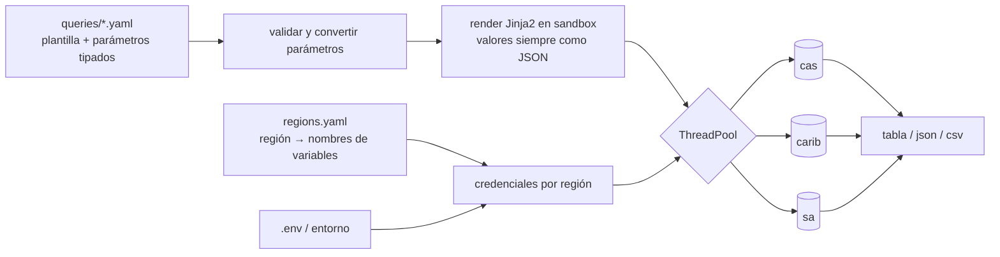

# multicloud-query-cli

[](https://github.com/tomaseduar60/multicloud-query-cli/actions/workflows/ci.yml)


CLI para correr **queries parametrizadas** contra MongoDB y Couchbase en **varias regiones a la vez**, cada una con sus propias credenciales.

Nace de un problema concreto: las mismas consultas de soporte se repetían a mano en cada región, copiando y pegando URIs y cambiando valores a ojo. Con `qcli` la query se escribe una vez en YAML, los parámetros se validan antes de tocar la base, y la misma consulta corre en todas las regiones en paralelo.

```console
$ qcli run orders_by_status -r all -p status=PAID -p days=3
region  orderId  customerId  total   status
------  -------  ----------  ------  ------
cas     A-1029   C-77        125.40  PAID
carib   B-5512   C-90        88.00   PAID

[cas] 1 filas (182 ms)
[carib] 1 filas (240 ms)
[sa] 0 filas (205 ms)
```

## Cómo funciona



### Regiones y credenciales

[`regions.yaml`](regions.yaml) es un diccionario región → engine → **nombre de variable de entorno**. El archivo se versiona; los valores no:

```yaml
regions:
  cas:
    mongo:
      uri_env: MONGO_URI_CAS
    couchbase:
      connstr_env: COUCHBASE_CONNSTR_CAS
      username_env: COUCHBASE_USER_CAS
      password_env: COUCHBASE_PASSWORD_CAS
  carib: ...
  sa: ...
```

Si a una región le falta una variable, el error dice exactamente cuál. `Credentials` nunca imprime sus valores, ni siquiera en un traceback.

### Queries

Cada archivo en [`queries/`](queries) declara engine, operación, parámetros y plantilla:

```yaml
description: Pedidos por estado en los últimos N días
engine: mongo
operation: find
target: {database: sales, collection: orders}
params:
  status: {type: str, required: true, choices: [PENDING, PAID, SHIPPED, CANCELLED]}
  days: {type: int, default: 7}
template: |
  filter:
    status: {{ status }}
    $expr:
      $gte: ["$createdAt", {$dateSubtract: {startDate: "$$NOW", unit: day, amount: {{ days }}}}]
```

Tipos soportados: `str`, `int`, `float`, `bool`, `date`, `list`.

## Seguridad

- **Sin inyección.** Todo `{{ valor }}` pasa por `json.dumps` antes de entrar en la plantilla (`finalize` de Jinja2), así un parámetro no puede romper la estructura de la query. En Couchbase además viajan como parámetros con nombre del SDK.
- **Sandbox.** Las plantillas corren en `SandboxedEnvironment` con `StrictUndefined`: una variable faltante es un error, no un string vacío.
- **Solo lectura por defecto.** `update_many` y `delete_many` exigen `--allow-write` y una confirmación que muestra en qué regiones va a escribir. En Couchbase las queries de lectura van con `readonly=True`.
- **Cero credenciales en el repo.** Solo `.env.example`; `.env` está en `.gitignore`.

## Uso

```bash
pip install "multicloud-query-cli[mongo,couchbase]"
cp .env.example .env    # completar con usuarios de solo lectura

qcli list
qcli show daily_sales
qcli run daily_sales -r all -p from=2024-05-01 -p to=2024-05-31 -o csv > ventas.csv
qcli run customer_profile -r sa -p customer_id=C-77 --dry-run
```

| Flag | Qué hace |
|---|---|
| `-r, --region` | Región, repetible. `all` o vacío = todas |
| `-p, --param` | `clave=valor`, repetible |
| `-o, --output` | `table`, `json` o `csv` |
| `--dry-run` | Muestra la query renderizada sin conectarse |
| `--allow-write` | Habilita operaciones que modifican datos |

Si alguna región falla, el resto igual se muestra y el comando sale con código `2`, para que un script pueda detectarlo.

## Estructura

```
src/query_cli/
├── cli.py          # comandos list / show / run
├── regions.py      # regiones y credenciales por región
├── queries.py      # definición de queries y parámetros tipados
├── render.py       # Jinja2 en sandbox
├── runner.py       # ejecución paralela con errores aislados por región
├── output.py       # tabla, json, csv
└── engines/        # mongo, couchbase (drivers con import diferido)
```

## Desarrollo

```bash
pip install -e ".[dev]"
ruff check . && ruff format --check . && mypy . && pytest --cov
```

Los tests usan un engine en memoria registrado en lugar de los drivers reales, así cubren todo el flujo (regiones, render, ejecución paralela, CLI) sin levantar bases de datos.

## Licencia

[MIT](LICENSE)
